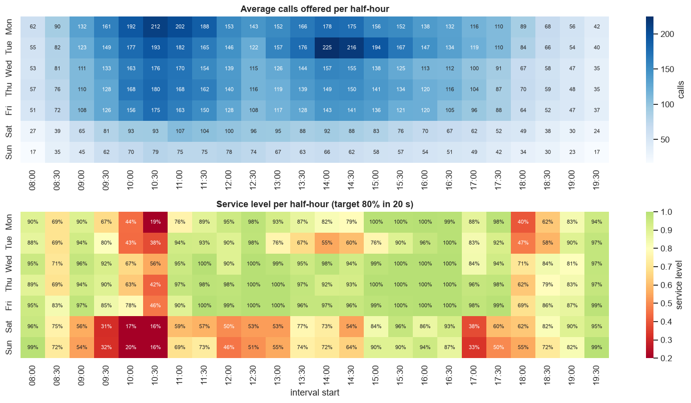
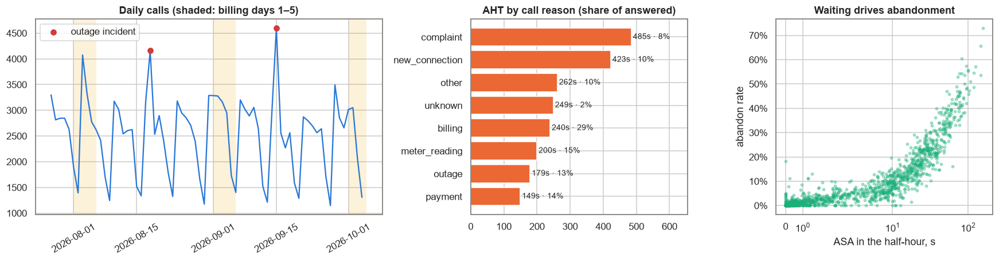
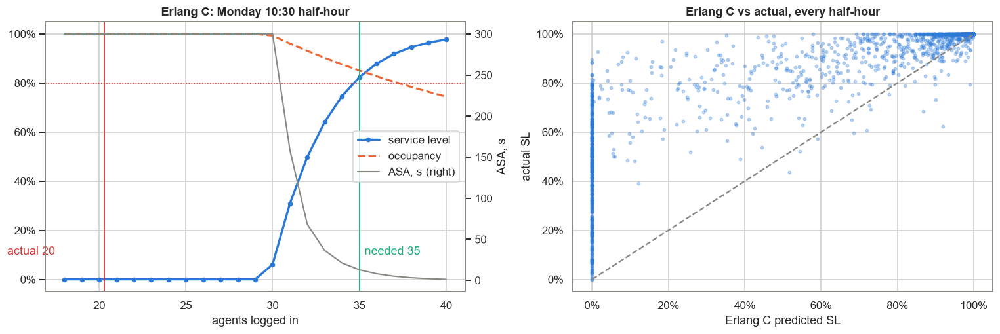
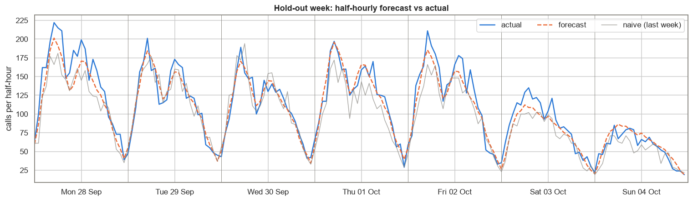
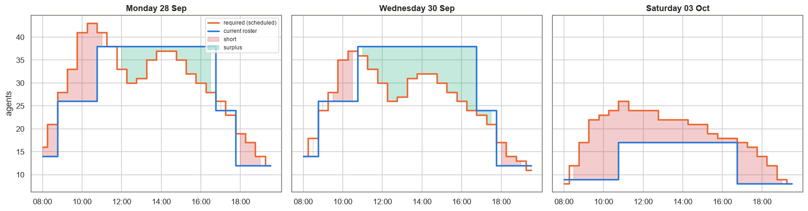
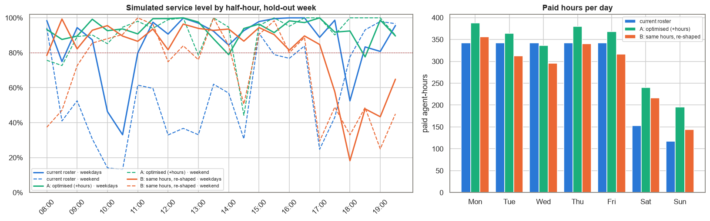

# Baku Utility Hotline — Call Centre Workforce Planning

**Daily Data Analytics Project · Day 12**

## Business question
A Baku utility company runs a customer hotline (08:00–20:00, 7 days a week) for billing, payments, outages, meter readings and new connections. The monthly report says the centre "meets the 80/20 target" (80% of calls answered within 20 seconds), yet customers complain about long waits on Monday mornings and at weekends. **Where and why is the service level missed, how many agents are really needed in each half-hour, and how much of the gap can a better shift pattern close — with the same paid hours, and with more?**

What the project does:
1. Cleans 177k calls over 10 weeks (27 Jul – 4 Oct 2026) and the half-hourly roster.
2. KPIs and EDA: service level, abandonment, ASA, AHT, occupancy by weekday × half-hour, billing cycle, outage incidents.
3. **Erlang C written from scratch**, validated against 1,680 real half-hours.
4. **Forecast** of the hold-out week (log-linear daily model × intraday profile) vs a naive baseline.
5. **Staffing requirement** per half-hour (80/20, occupancy ≤ 90%, grossed up for shrinkage).
6. **Shift scheduling as a MILP** (SciPy `milp`): minimum paid hours (scenario A) and best use of today's hours (scenario B).
7. **Discrete-event queue simulation** that replays the hold-out week's real calls through each roster.

## Key KPIs (from the executed notebook)
| KPI | Value |
|---|---|
| Calls offered | 177,208 (2,532 per day) |
| Service level (answered ≤ 20 s) | **80.8%** overall, but **33.4% of half-hours miss 80/20** |
| Service level by day | Wed–Fri ~90%, Mon 79.9%, **Tue 76.3%, Sat/Sun ~61%** |
| Abandon rate | 8.2% (Sat/Sun 18%) |
| ASA / P90 wait | 9.0 s / 35 s |
| AHT / occupancy | 252 s / 72.7% |
| Shrinkage | 20.7% (scheduled vs logged-in agents) |
| Scheduled hours per week | 1,980 (≈ AZN 17,820 at an assumed AZN 9/h) |
| Billing-cycle effect (days 1–5) | +14.8% calls |
| Mean caller patience | 178 s; 2.1% of calls hang up within 5 s |
| Monday 10:30 half-hour | 212 calls, 29.8 erlangs: Erlang C needs **35** agents, only **20** logged in on average (actual SL 20%) |
| Erlang C accuracy | mean error 3.5% when SL ≥ 80%; pessimistic when under-staffed (predicts 24% vs 63% actual) |
| Forecast WAPE, hold-out week | daily **5.2%** vs 11.4% naive; half-hourly **9.7%** vs 15.5% |
| Required hours, hold-out (billing) week | 2,051 vs 1,980 scheduled; 264 h short, 193 h surplus in the wrong places |
| Simulator check (current roster) | simulated SL 78.1% vs actual 78.2% |
| **A: optimised roster** | 2,272 h/week (**+14.7%**, ≈ AZN +2,628/week): SL 78% → **93%**, abandon 8.8% → **2.7%**, half-hours below 80/20: 62 → 19 |
| **B: same 1,980 hours, re-shaped** | SL 78% → 83%, abandon 8.8% → 6.8%, half-hours below 80/20: 62 → 61 |

## Charts
### Demand and service level by weekday × half-hour


### Billing cycle, incidents, handle time, abandonment


### Erlang C


### Forecast vs actual (hold-out week)


### Required vs scheduled agents


### Roster scenarios (simulated)


## Findings & recommendations
| Area | Evidence | Recommendation |
|---|---|---|
| Hidden misses | Headline 81% hides a third of half-hours below target; weekends 61%, Tuesday 76% | Report SL per half-hour and per day; alert on any interval below 70% |
| Roster shape | Flat 08/09/11 weekday pattern: short 08:30–11:00 and at 18:00, surplus 13:00–17:00 and midweek | Replace the three fixed shifts with staggered starts and 4-hour part-time peak shifts |
| A: meet 80/20 everywhere | +14.7% hours (mostly part-time peak and weekend shifts) → SL 93%, abandon 2.7% | Needed in billing weeks; plan the extra hours as part-time peak and weekend shifts |
| B: same hours, re-shaped | SL 83%, abandon 6.8%, almost all of the gain is at weekends | A free first step, but not enough on its own |
| Billing cycle | Days 1–5 bring +15% calls; naive "same day last week" forecast error is twice as large | Forecast with weekday + billing-day effects; lock leave and training out of days 1–5 |
| Outage incidents | Two outage afternoons added +1,100 and +1,600 calls vs the same weekday a week earlier | Push outage status to IVR / SMS within 15 minutes; keep a "surge" list of back-office staff |
| Long calls | Complaints and new connections take 7–8 min vs 4.2 min average | Route new connections to an online form / callback queue |

**Bottom line:** the problem is both *shape* and *size*. Re-shaping the same hours mainly rescues the weekends; it cannot fix the weekday morning peaks because a billing week needs more hours than today's roster has. Meeting 80/20 almost everywhere needs about 15% more hours, mostly short part-time shifts at the peaks and on weekends. Scenario B's objective weights large peaks most, so it also gives up the weekday evening (17:00–20:00) and needs a manual review before use.

*Caveats: Erlang C assumes Poisson arrivals and no abandonment; shrinkage is a single average ratio (real break planning adds constraints); the hold-out week is a billing week, so scenario A's extra hours are a peak-week figure; the simulator shares its queue logic with the synthetic data generator, so on real data it should first be validated against actual results (as done here for the current roster). Agent cost is an assumption.*

## Methods
- **Erlang C** (`wfm.erlang_c`): Erlang B recursion → probability of waiting; `SL = 1 − C·exp(−(N−A)·T/AHT)`, `ASA = C·AHT/(N−A)`. Required agents = smallest N with SL ≥ 80% in 20 s and occupancy ≤ 90%.
- **Service level** excludes abandons under 5 seconds, a common industry convention.
- **Forecast:** `log(daily calls)` on weekday dummies, billing-day flags (days 1–5, 6–10) and a weekly trend, with a log-variance correction; outage-incident days are excluded from training; days are split with a weekday/weekend intraday profile.
- **Shrinkage:** required net agents ÷ (logged-in / scheduled) = scheduled agents.
- **MILP:** integer shift counts (8 h full-time, 4 h part-time at any half-hour start ending by 20:00, part-time ≤ 30% of hours). A: minimise paid hours subject to coverage ≥ requirement. B: fixed weekly hours, minimise squared-weighted shortfall.
- **Simulator** (`wfm.simulate_day`): FCFS multi-server queue with agent logins that change every half-hour and caller abandonment. Handle times and patience are taken from the real calls; abandoned callers keep their real time to abandon, answered callers get a patience draw from the fitted exponential distribution.

## Tech stack
Python · pandas · NumPy (**Erlang C and queue simulator written from scratch**) · SciPy (`milp` integer programming) · matplotlib · seaborn · nbformat / nbconvert

## Structure
```
data/generate_data.py                 synthetic call generator (seed 42) with injected data issues
data/calls.csv                        177k raw call records (arrival, reason, wait, abandon, handle time)
data/roster.csv                       scheduled and logged-in agents per half-hour
wfm.py                                cleaning, Erlang C, simulator, MILP schedulers
build_notebook.py                     builds the analysis notebook
call_centre_workforce_planning.ipynb  executed analysis
images/                               charts
```

## Run
```bash
pip install -r requirements.txt
python data/generate_data.py
python build_notebook.py
python -m nbconvert --to notebook --execute --inplace call_centre_workforce_planning.ipynb
```

> **Note:** all data is synthetic (fixed random seed). It does not describe any real company, customer or call centre.

## 🇦🇿 Azərbaycanca xülasə
Bakıdakı kommunal şirkətinin zəng mərkəzinin 10 həftəlik (177 min zəng, sintetik data) məlumatı ilə **iş qüvvəsi planlaşdırması** aparılıb. Aylıq göstərici "80/20 hədəfi ödənir" (SL 80.8%) deyir, amma yarım saatlıq intervalların **33%-i hədəfi buraxır**: çərşənbə axşamı SL 76%, həftəsonu isə cəmi 61%-dir. Erlang C sıfırdan yazılıb və 1,680 real intervalla yoxlanılıb (SL ≥ 80% olanda orta xəta 3.5%). Zəng sayı faktura günlərində (ayın 1–5-i) **+15%** artır, loqarifmik model hold-out həftəsində gündəlik xətanı 11.4%-dən 5.2%-ə endirir. Növbə cədvəli tam ədədli proqramlaşdırma (MILP) ilə qurulub və real zənglər simulyatorda yenidən oynadılıb: **eyni 1,980 saatla** yenidən bölgü SL-i 78%-dən 83%-ə qaldırır (əsasən həftəsonu), **hədəfi hər yerdə təmin etmək üçün** isə təxminən **+15% saat** (əsasən 4 saatlıq part-time növbələr) lazımdır: SL 93%, tərk edilmiş zənglər 8.8%-dən 2.7%-ə düşür.
